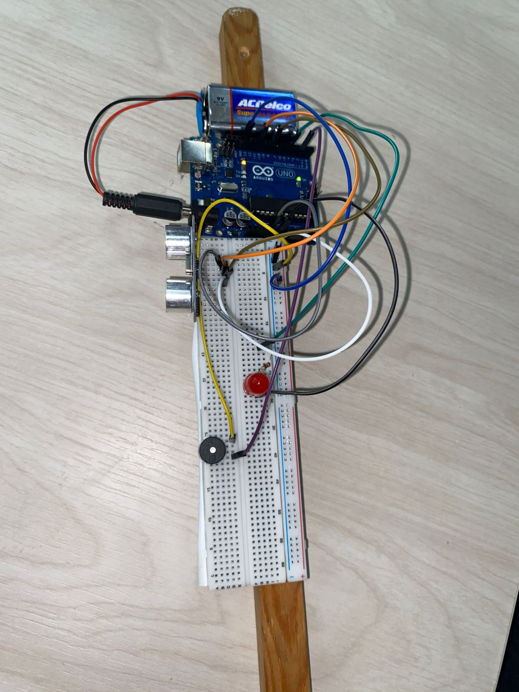
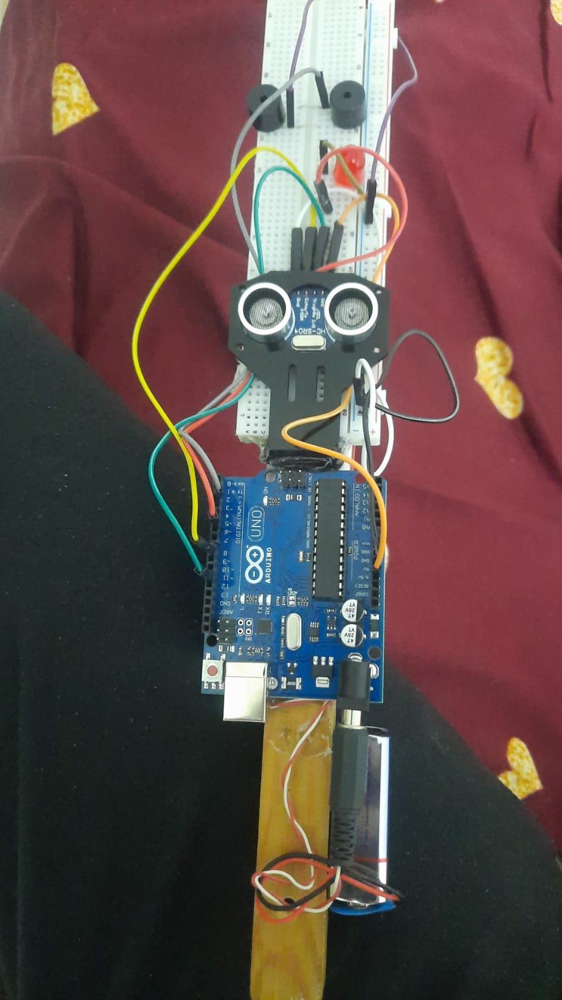
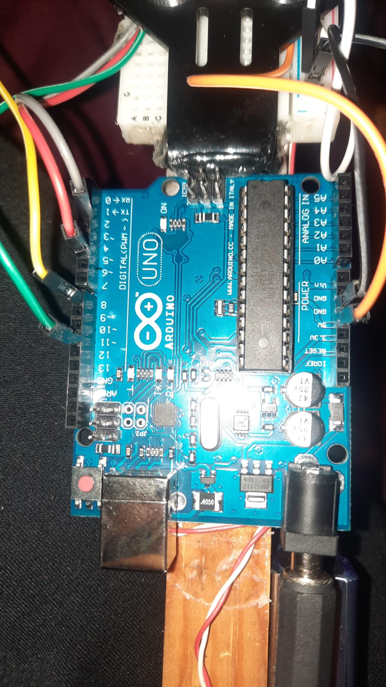

# Smart Stick for the Blind (IoT)

An Arduino-based smart stick that detects obstacles in front of a visually impaired user and warns them with a buzzer and an LED. Built as an 11-person university IoT team project, academic year 2025 / 2026.

## How it works

1. The HC-SR04 ultrasonic sensor sends a short pulse and waits for the echo.
2. The Arduino measures the echo time and calculates the distance: `distance = duration * 0.034 / 2` (cm).
3. If the distance is 20 cm or less, the buzzer sounds and the LED turns on.
4. If the path is clear, both stay off.

## Components

| Component | Model / type | Purpose |
| --- | --- | --- |
| Microcontroller | Arduino UNO | Main processing unit |
| Ultrasonic sensor | HC-SR04 | Distance measurement |
| Buzzer | Active buzzer | Audible alert |
| LED | Red LED (with resistor) | Visual alert |
| Breadboard and wires | | Circuit assembly |
| Power | 9V battery | Portable power |

## Pins

| Part | Arduino pin |
| --- | --- |
| HC-SR04 TRIG | 11 |
| HC-SR04 ECHO | 8 |
| Buzzer | 2 |
| LED | 5 |
| HC-SR04 VCC / GND | 5V / GND |

## Code

The sketch is in [`Project.ino`](Project.ino). Open it in the Arduino IDE, select Arduino UNO, upload, and open the Serial Monitor at 9600 baud to see the distance readings.

## Demo videos

Final build working: [demo 1](demo_1.mov), [demo 2](demo_2.mov), [demo 3](demo_3.mov), [demo 4](demo_4.mov).

## Documentation

- [Project documentation (PDF)](Smart_Stick_Project_Documentation.pdf)
- [Presentation (PPTX)](Smart_Stick_Presentation.pptx)

## Photos

| Final build | Early prototype | Arduino close-up |
| --- | --- | --- |
|  |  |  |

## Team

Abdelrahman Mamdouh Rabie Ahmed, Abdelrahman Eid Ahmed Abdel Wahab, Habiba Ahmed Talaat, Ali Hamdi Mohamed, Manar Nady Helmy, Menna Mohamed Abdel Moez Rashad, Abdelrahman Hany Issa, Ali Zaki Ali, Mayar Milad Atef, Abdelrahman Mostafa Ibrahim, Mohamed Ayman Abdel Aziz.
